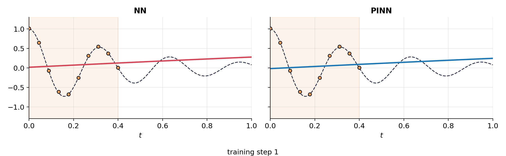
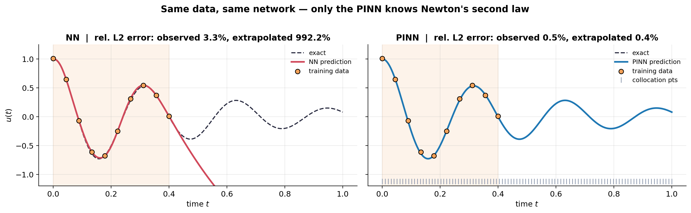
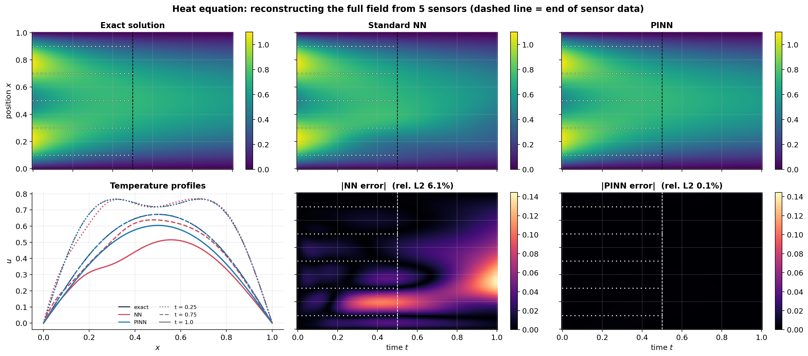
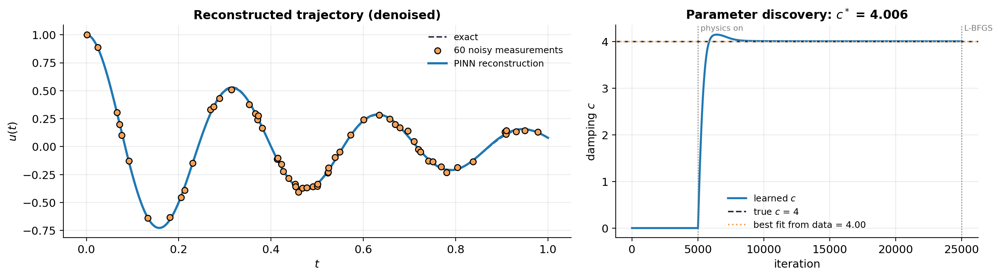

# Physics-Informed Neural Networks vs. Standard Neural Networks

[](https://colab.research.google.com/github/YOUR-USERNAME/pinn-vs-nn/blob/main/PINN_vs_NN.ipynb)


A from-scratch PyTorch implementation of **Physics-Informed Neural Networks (PINNs)**, compared head-to-head with an otherwise identical standard neural network. The only difference between the two models is one term in the loss: the residual of the governing differential equation.



## Why PINNs?

A standard NN learns only from data, so it has no idea what to do where data is missing. A PINN is also penalised for violating the laws of physics at thousands of unlabelled "collocation" points, computed with automatic differentiation:

```
L_PINN = L_data  +  λ_ic/bc · L_ic/bc  +  λ_phys · (1/N_c) Σⱼ r_θ(xⱼ)²
```

- **L_data**: fit the measurements
- **L_ic/bc**: satisfy the initial and boundary conditions
- **physics term**: the equation's residual r must be zero at every collocation point

## Experiments

| # | Problem | Equation | Task |
|---|---------|----------|------|
| 1 | Damped harmonic oscillator | `m·u'' + c·u' + k·u = 0` | Extrapolate from 10 noisy points in the first 40% of the time window |
| 2 | Damped oscillator (inverse) | same, damping `c` unknown | Discover the damping coefficient from noisy data |
| 3 | 1-D heat equation | `∂u/∂t = α·∂²u/∂x²` | Reconstruct the full space-time field from 5 sensors |

Every comparison is fair: same architecture, initial weights, data, optimiser and number of steps.

## Results

| Relative L2 error | Standard NN | PINN |
|-------------------|:-----------:|:----:|
| Oscillator, observed window (t ≤ 0.4) | 3.32% | **0.45%** |
| Oscillator, extrapolation (t > 0.4) | 992% | **0.35%** |
| Heat equation, observed period (t ≤ 0.5) | 3.77% | **0.13%** |
| Heat equation, extrapolation (t > 0.5) | 8.82% | **0.11%** |
| Inverse problem: learned damping c (true = 4.0) | n/a | **4.006** (0.14% error) |

Outside the observed window, the standard NN's error explodes (≈10× the signal size) while the PINN stays below 0.5%. In the inverse problem the PINN recovers c = 4.006, essentially matching the best estimate the noisy data can support (4.002, from a direct fit of the closed-form solution).

**Oscillator:** both models fit the data, but only the PINN follows the physics beyond it.


**Heat equation:** field reconstruction and error maps.


**Inverse problem:** starting from a wrong guess (c = 0), the damping coefficient converges to its true value.


## Key takeaways

- **Physics generalises where data can't.** The baseline matches the PINN inside the observed region and fails outside it.
- **Low training loss ≠ valid model.** The baseline fits its data while violating the governing equation by orders of magnitude.
- **Inverse problems for free.** Unknown physical parameters can be learned alongside the network weights.
- **Practical details matter.** Non-dimensionalising the residual, `tanh` activations (ReLU has zero second derivative) and Adam → L-BFGS training are what make it work. For the inverse problem, a data-only warm start was essential: training jointly from scratch locked c onto a wrong value.

## Run it

```bash
git clone https://github.com/YOUR-USERNAME/pinn-vs-nn.git
cd pinn-vs-nn
pip install -r requirements.txt
jupyter notebook PINN_vs_NN.ipynb
```

Runs in about 10 minutes on a laptop CPU (a few minutes on a GPU). All figures are saved to `figures/`.

## Repository structure

```
├── PINN_vs_NN.ipynb   # full notebook: theory, code, results
├── figures/           # generated plots and training GIF
├── requirements.txt
└── README.md
```

## References

- Raissi, Perdikaris & Karniadakis (2019). *Physics-informed neural networks.* J. Comput. Phys. 378, 686–707.
- Karniadakis et al. (2021). *Physics-informed machine learning.* Nature Reviews Physics 3, 422–440.
- Wang, Teng & Perdikaris (2021). *Understanding and mitigating gradient flow pathologies in PINNs.* SIAM J. Sci. Comput.
